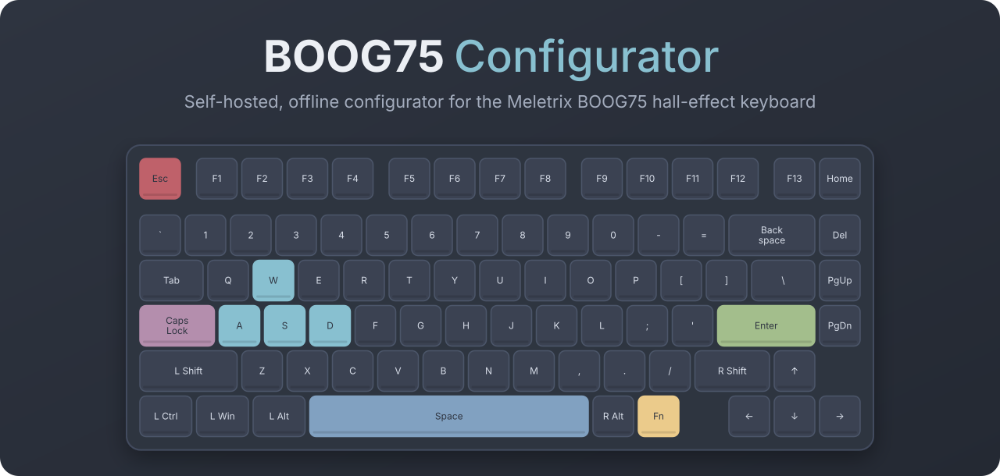
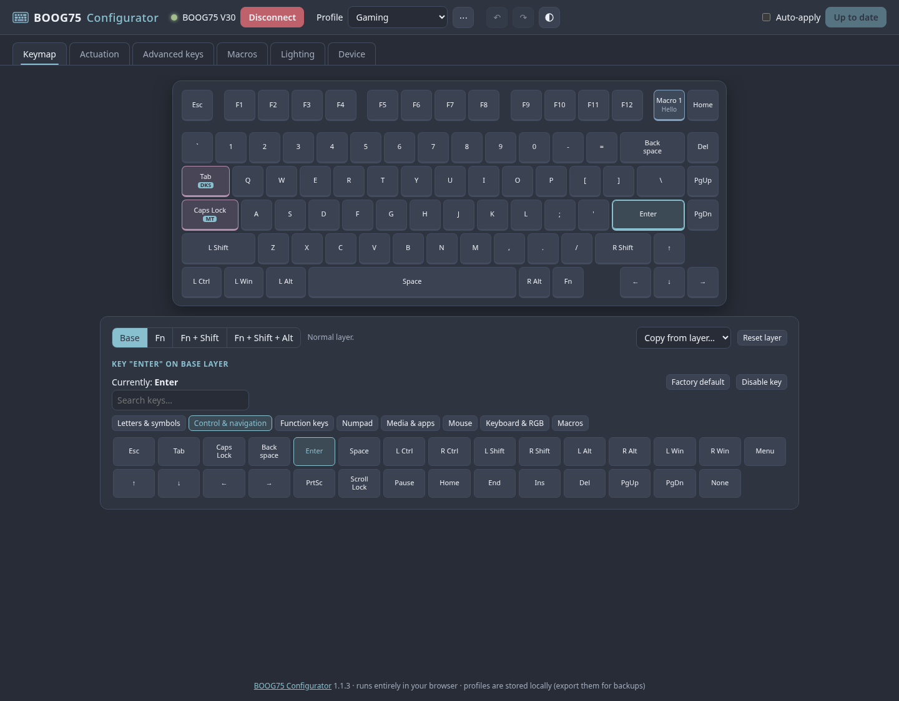
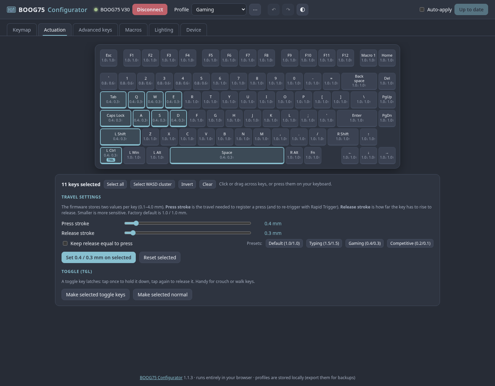
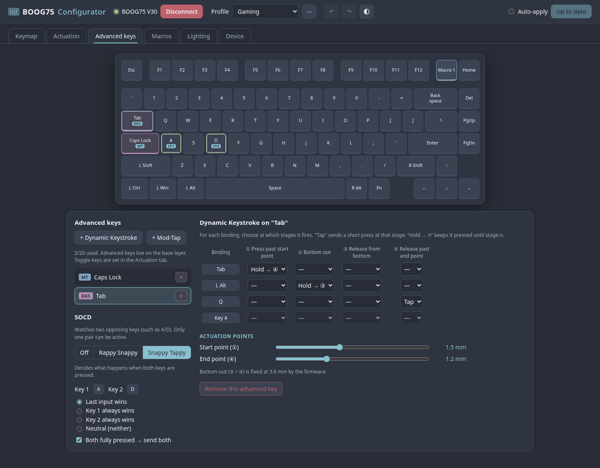
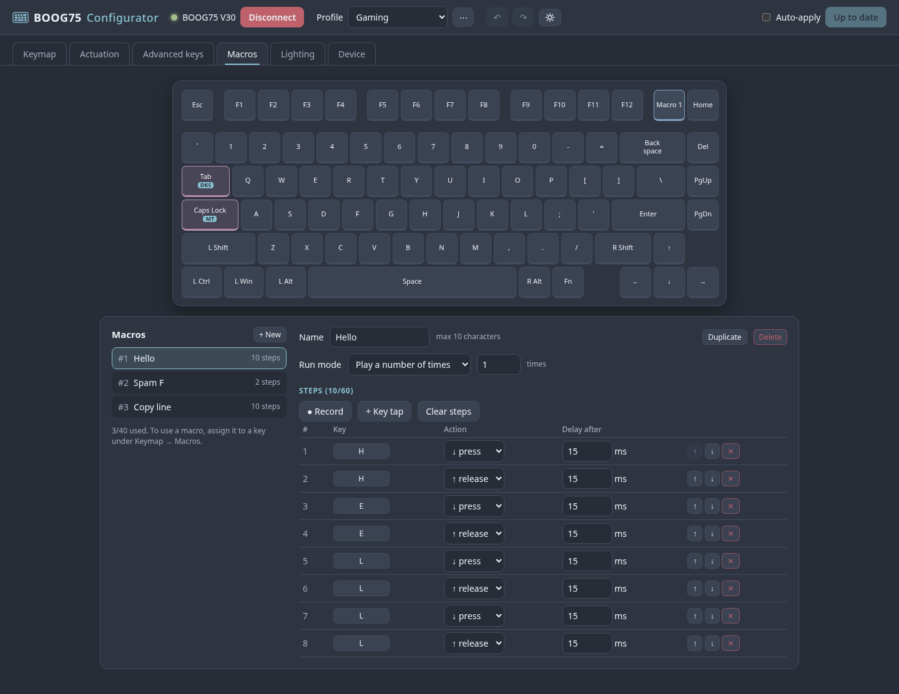
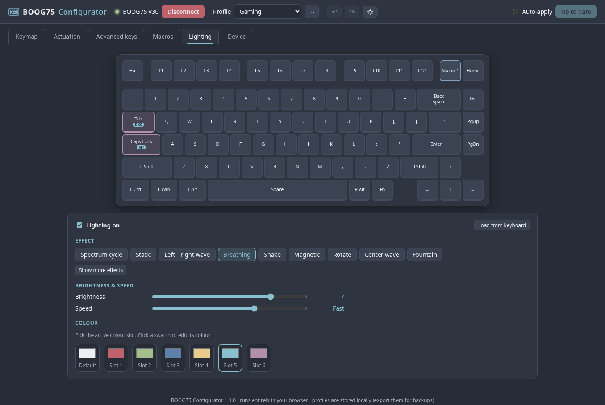

<p align="center">
  
</p>

<p align="center">
  An unofficial, self-hostable replacement for <code>boog75.meletrix.com</code>:
  configure your Meletrix BOOG75 from the browser, offline, with no Meletrix servers involved.
</p>

<p align="center">
  
</p>

> Not affiliated with Meletrix. It only configures the keyboard and never
> flashes firmware. Every USB frame matches what the official tool sends for the
> same settings, but use it at your own risk.

## Features

- **Keymap**: all 4 layers, searchable keycode picker, macros on any key, layer copy
- **Actuation**: per-key press/release stroke 0.1–4.0 mm (Rapid Trigger), presets, toggle keys
- **Advanced keys**: Dynamic Keystroke and Mod-Tap (up to 20), Snappy Tappy / Rappy Snappy (SOCD)
- **Macros**: up to 40 × 60 steps, recorder, run modes, read back from the keyboard
- **Lighting**: effects, brightness, speed, 7 colour slots
- **Profiles**: unlimited, undo/redo, JSON export/import, imports official-site exports
- **Safe syncing**: sends only what changed, one frame at a time, with a dry-run mode and USB log
- **Nord theme**: dark and light

| Actuation | Advanced keys |
|---|---|
|  |  |
| **Macros** | **Lighting** |
|  |  |

## Compatibility

Works in **Chrome, Chromium, Edge or Brave** on **Windows, macOS, Linux and
ChromeOS**: anywhere desktop Chromium supports WebHID. Linux needs a
one-time udev rule (below). Firefox, Safari and mobile browsers can't talk to
USB devices.

## Quick start

```bash
./start.sh                       # local: http://127.0.0.1:8075, opens your browser
docker compose up -d --build     # or with Docker: http://localhost:8075
```

Click **Connect** and pick the keyboard.

**Linux only**, once:

```bash
sudo cp udev/70-boog75.rules /etc/udev/rules.d/
sudo udevadm control --reload-rules && sudo udevadm trigger   # then replug the keyboard
```

## Self-hosting

The image is a read-only, non-root nginx serving static files on port **8080**
(health check: `/healthz`).

```yaml
services:
  boog75:
    image: hadinaqvi/boog75-config:latest
    restart: unless-stopped
    ports: ["127.0.0.1:8075:8080"]   # or skip ports and use your proxy's network
    read_only: true
    tmpfs: ["/tmp:size=16m,noexec,nosuid,nodev"]
    cap_drop: [ALL]
    security_opt: ["no-new-privileges:true"]
```

- **HTTPS is required.** Browsers only allow WebHID on `https://` or
  `http://localhost`, so put it behind a reverse proxy, Cloudflare Tunnel,
  Tailscale (`tailscale serve`) or an SSH tunnel.
- **Where the keyboard goes:** the keyboard talks to *your browser*, not the
  server. Plug it into the computer you browse from.
- **Profiles** live in each browser's local storage. Export them for backups.

## Good to know

- **Keymap and actuation can't be read back from the keyboard** (the official
  tool can't either). The app remembers what it last wrote. If you changed
  settings elsewhere, use *Device → Forget keyboard state*. Lighting, macros and
  the firmware version are read from the keyboard.
- **Keeping your current setup:** export it from the official site and import
  it here.
- **Firmware below V28:** handled automatically. DKS, Snappy Tappy and Rappy
  Snappy need V29+ per Meletrix's changelog.
- **Firmware updates** need Meletrix's own updater. Zoom75 Tiga firmware is a
  different keyboard; don't flash it.
- **Page never loads in Docker while a VPN is on?** The VPN is likely capturing
  Docker's network range.

## Development

No build step and no dependencies: edit the files and reload.

```bash
npm test                  # protocol, profile, transport and layout tests (Node ≥ 18)
tests/run-ui-test.sh      # headless end-to-end UI test against a fake keyboard
```

Protocol tests check every frame against 700+ test vectors recorded from the
official configurator (`tests/fixtures/`). The repo contains recorded data
only, no Meletrix code. For releases, bump the version in `package.json`,
`js/app.js` and the `Dockerfile` label.

<details>
<summary><b>Project layout</b></summary>

```
index.html, css/style.css   page and Nord theme
js/protocol.js              frame encoders/decoders
js/profile.js               profile model, validation, import, sync diff
js/device.js                WebHID transport (serialized queue, timeouts)
js/app.js                   UI
js/keycodes.js, layout.js   keycodes and physical layout
tests/                      unit tests, fixtures, headless UI test
docs/                       README cover image and screenshots
```
</details>

<details>
<summary><b>Fixes over the official tool</b></summary>

- Writes are queued and awaited with timeouts instead of fired all at once
  (the likely cause of the official site freezing on Linux).
- Deleting a Snappy Tappy pair clears the correct slot. The official tool
  clears the Rappy Snappy slot instead, and vice versa.
- Switching between Snappy Tappy and Rappy Snappy clears the old pair first.
- Every byte is range-checked before it's sent.
</details>

<details>
<summary><b>Protocol summary</b></summary>

Worked out for interoperability from the official web app's traffic and the
keyboard's HID descriptor. Vendor interface: usage page `0xFF01`, no report ID,
64-byte reports, USB IDs `36b5:2f8f`.

Frame: `[00, cmd, 00, len, sub, data…, checksum]`, zero-padded. The checksum
directly follows the payload, and all bytes up to it sum to `0x55`.

| cmd | Dir | Purpose |
|---|---|---|
| `0x02` | ↔ | firmware version |
| `0x18` / `0x19` | → / ↔ | set / get lighting |
| `0x5A` | → | base-layer keymap (3 chunks × 29 keys) |
| `0x1C` | → | one key on Fn layer 1–3 |
| `0x70` | → | per-key mode, press and release stroke (6 chunks) |
| `0x60` | → | macros; DKS/MT on firmware ≥ V28 |
| `0x34` | → | SOCD pairs; DKS/MT on firmware < V28 |
| `0x61` | ↔ | read macro |
| `0x05` | ← | ack |

Keycodes are Windows virtual-key codes; `0x98` = macro, `0xDA` = advanced key.
See `js/protocol.js` for details.
</details>

## License

[MIT](LICENSE). Meletrix, BOOG75 and Zoom75 are trademarks of their owners,
used only to describe compatibility.
